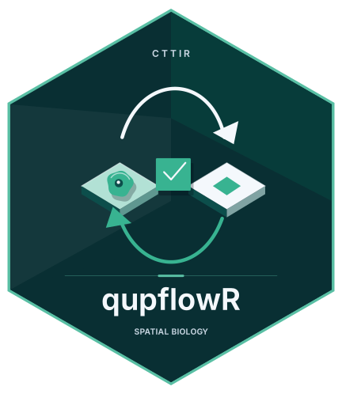

# qupflowR 

[](https://github.com/CTTIR/qupflowR/actions/workflows/R-CMD-check.yaml)

Experimental R foundations for a planned QuPath interface. This first source
milestone contains classified conditions and bilingual messages, protocol JSON
helpers, a JSON Schema subset validator, synthetic contract fixtures and
`qp_run_external()`, a pinned external-method execution boundary.

The live Java bridge, interactive application, project editing, queued jobs and
shareable workflow engine are not included in this milestone. The protocol
schemas describe future interfaces; their presence does not implement them.
No release or CRAN acceptance is claimed.

## Installation and requirements

R >= 4.5.0 is declared. The current candidate was checked locally on Linux with
R 4.6.1; the complete cross-platform CI matrix is a separate qualification.
Java and QuPath are not needed to install or load these foundations. Optional
packages listed in Suggests support tests or planned features and are loaded
only where used. No runtime or model is downloaded automatically.

Install the development package and its vignette from GitHub:

```r
install.packages("remotes")
remotes::install_github("CTTIR/qupflowR", build_vignettes = TRUE)
```

From a checked-out source tree, use `R CMD build .`, then
`R CMD INSTALL qupflowR_0.0.0.9000.tar.gz`.

## Quick start

This example uses only the implemented R foundations and synthetic values:

```r
library(qupflowR)
payload <- list(image_id = qp_scalar("synthetic-image"), object_ids = c("1", "2"))
json <- qp_json_encode(payload)
qp_json_decode(json)$object_ids
#> [1] "1" "2"
qp_value_state(c(1.5, NA_real_, NaN, Inf, -Inf))
#> [1] "finite" "missing" "nan" "pos_inf" "neg_inf"
```

Mark scalar JSON fields with `qp_scalar()`; unmarked vectors remain arrays,
including vectors of length one. IDs remain character values. These helpers
encode protocol data; they do not connect to QuPath or modify a project.

## Documentation and support

The [getting-started vignette](vignettes/qupflowR.Rmd) covers conditions, messages,
JSON, schema validation and a runnable synthetic external-method example. After
installing with vignettes, open `vignette("qupflowR", package = "qupflowR")`.
Use `help(package = "qupflowR")` for complete argument and return-value contracts,
and `citation("qupflowR")` for the installed package's citation.

Report reproducible problems with synthetic inputs at
<https://github.com/CTTIR/qupflowR/issues>. Contributor conventions are in the
[CTTIR contributing guide](https://github.com/CTTIR/.github/blob/main/CONTRIBUTING.md).
The local documentation site uses `themakR` and builds into `site/`; a local
build does not establish that the public website is deployed.

## Existing-method execution

`qp_run_external()` requires explicit trust, an executable/argument vector,
SHA-256 pins for declared executable/script/runtime/model/input files and a new
workspace. It uses a private child environment, checks inputs again after the
process, retains logs and a receipt, and hashes required outputs. Receipts may
contain private paths or caller environment values and belong with private run
artifacts, not in public repositories.

The external-execution profile is Linux-only. It is a hygiene boundary for
trusted code, not a sandbox. Callers must declare transitive dependencies and
validate analytical outputs themselves. `execution_complete` means process
success and declared output presence, not biological validity or equivalence.
Scripts, model versions, detector settings and measurement definitions are not
rewritten. An older QuPath command-line method can therefore be executed
independently of the planned QuPath 0.7/Java 25 live bridge.

## Validation and development

Run `testthat::test_local()` from R. Generated native-image tests require a
separate explicitly configured fixture tree; their skips do not qualify native
QuPath execution. The synthetic schema/geometry oracles are included. The
native fixture generator and Java scaffold are outside this source milestone.

The retained quality gate supports lint, API and coverage checks:

```sh
QUPFLOWR_CTTIR_GITHUB= Rscript tools/quality.R --mode all --report
```

An empty `QUPFLOWR_CTTIR_GITHUB` selects the hash-pinned vendored house linters;
no local sibling checkout is required. The committed API history and coverage
baseline are retained unchanged. Shared CI workflow callers are pinned to their
existing source revision. Hosted CI success, browser behavior, native runtime
qualification and second-computer reproduction are separate evidence states.

## License

GPL (>= 3), with the full text in `LICENSE.md`. Package code is attributed to
the maintainer declared in DESCRIPTION. External engines and dependencies are
not bundled and retain their own licenses. MIT consumers should use the agreed
external process/file interface rather than silently importing GPL code.

## Use of LLM tools

Where applicable, LLM tools were used for narrowly defined, non-authorial tasks:
copyediting, prose refinement, Markdown/LaTeX formatting, boilerplate scaffolding
(such as CI configurations and build scripts), and code refactoring. Tools included
[Chat AI](https://kisski.gwdg.de/leistungen/2-02-llm-service/), the KISSKI
(GWDG) service, and self-hosted **Mistral Small (24B, Apache-2.0)** served through
a local **vLLM architecture** on an Ubuntu Linux workstation with Intel
processors and NVIDIA GPUs. The self-hosted model ran locally, with no data sent
to third parties.

All scientific claims, methodological choices, analyses, interpretations and
conclusions remain the authors' own. Where applicable, LLM-generated material
must be reviewed and revised before inclusion, and references must be verified
against their DOI, arXiv ID or ISBN.

Workstation software snapshot (14 October 2026): local, OpenAI-compatible vLLM
serving with **vLLM 0.28.1rc1.dev534+g613ab20f7**, **Python 3.12.13** and
**PyTorch 2.13.0**; **R 4.6.1** and **RStudio 2026.06.0+242**. These are
workstation versions, not per-project dependency or validation requirements.
